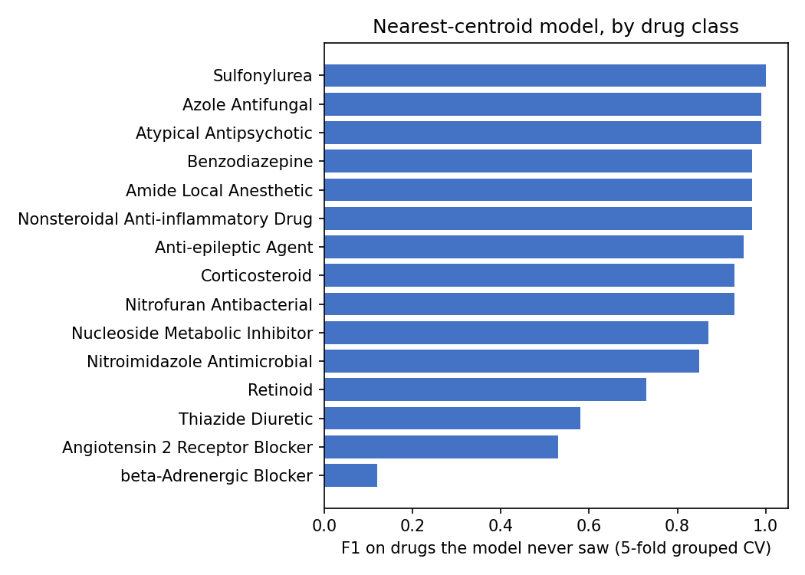

# Can a model tell a drug's class from the words on its FDA label?

I took the "Indications and Usage" text from prescription drug labels on openFDA and tried to predict each drug's pharmacologic class (FDA's EPC, for example "Thiazide Diuretic" or "Sulfonylurea"). TF-IDF features, a nearest-centroid classifier and a softmax regression, all written from scratch in numpy.

I'm a pharmacist, so the interesting part for me is where it fails.

## Data

openFDA drug label API (https://open.fda.gov/apis/drug/label/). `src/fetch.py` pulls 5,000 prescription labels that have an EPC class and an indications section. The raw file (23 MB) is not stored here, run the script to create it. After filtering to classes with at least 50 labels and at least 6 different drugs: 1,952 labels, 216 drugs, 15 classes.

## Method

- Tokenise, drop common words, and remove the drug's own name from its text.
- TF-IDF on the 4,000 most common words (words found in at least 5 labels).
- Cross-validation grouped by drug: all labels of the same drug (many manufacturers file one) stay on the same side of the split. Without this the same text appears in train and test, and the score looks much better than it is.
- Models: majority class, nearest centroid with cosine similarity, softmax regression with L2.

## Results

| Model | Accuracy | Macro F1 |
|---|---|---|
| Majority class | 0.07 | 0.01 |
| Nearest centroid | 0.88 | 0.83 |
| Softmax regression | 0.81 | 0.70 |

Softmax does worse here because it leans toward the big classes (corticosteroid has 368 labels). I did not rebalance it.

Per class (nearest centroid, `data/per_class_f1.csv`):

- Almost perfect: sulfonylureas 1.00, azole antifungals 0.99, atypical antipsychotics 0.99, benzodiazepines 0.97, NSAIDs 0.97. Their labels name a specific disease or use (diabetes, candida, schizophrenia, anxiety, arthritis).
- Weak: thiazide diuretics 0.58, angiotensin receptor blockers 0.53 and beta blockers 0.12. The top confusion is thiazide diuretic labelled as ARB (70 labels), then beta blocker as ARB (45).

That makes sense clinically. Thiazides, ARBs and beta blockers are all "indicated for hypertension". The label says what the drug is for, not how it works, so text alone cannot separate drugs that treat the same condition. Mechanism needs other fields.



## Limits

- Some class names appear in the text itself (for example "atypical antipsychotic", "retinoid", "antifungal"), which makes those classes easier than a label without them.
- 15 classes picked by label count, not a random sample of all drugs. The first 5,000 labels the API returns are not a random sample either.
- I used only the first EPC class when a drug has several.
- No hyperparameter tuning. Bag of words ignores word order.

## Run it

```
pip install numpy pandas requests matplotlib
python src/fetch.py
python src/analyze.py
```
